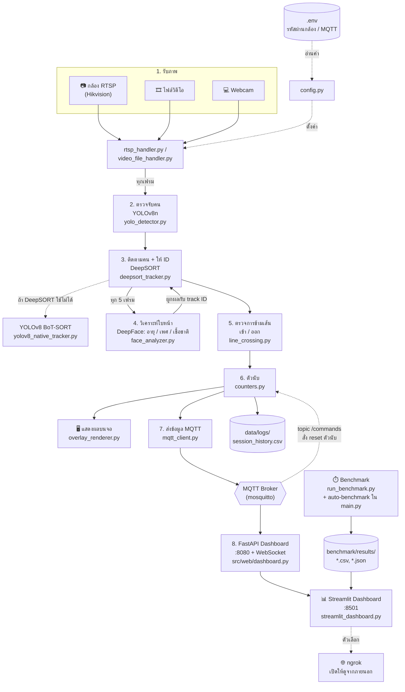

# 🤖 ระบบตรวจจับและนับจำนวนคนด้วยกล้องวงจรปิด (CCTV) ด้วย AI

## บทนำและภาพรวมโปรเจกต์

ระบบนี้ใช้เทคโนโลยี AI (YOLOv8 + DeepSORT) สำหรับตรวจจับและติดตามบุคคลในภาพจากกล้องวงจรปิด (CCTV) พร้อมฟังก์ชันนับจำนวนคนเข้า-ออกพื้นที่แบบเรียลไทม์ เหมาะสำหรับงานวิจัยและการประยุกต์ใช้งานในอุตสาหกรรมต่าง ๆ เช่น ความปลอดภัย, การจัดการพื้นที่, และการวิเคราะห์พฤติกรรมผู้ใช้บริการ

> 📋 **สถานะการพัฒนา:** มีรายการสิ่งที่ควรแก้ต่อ เรียงตามความสำคัญ — [ดูหัวข้อ "สิ่งที่ควรแก้ต่อ"](#todo)

---

## 🏗️ สถาปัตยกรรมระบบและจุดเด่น

### สถาปัตยกรรมหลัก

| องค์ประกอบ | หน้าที่ |
| :--- | :--- |
| **YOLOv8** | ตรวจจับวัตถุ (คน) ในภาพ |
| **DeepSORT** | ติดตามวัตถุแต่ละคนข้ามเฟรม |
| **DeepFace** | วิเคราะห์อายุ / เพศ / เชื้อชาติจากใบหน้า (RetinaFace + Facenet512) |
| **Line Crossing Analytics** | วิเคราะห์การเดินข้ามเส้นเพื่อระบุทิศทางเข้า-ออก |
| **MQTT** | ส่งข้อมูลสถิติไปยังระบบภายนอก |

### 🔄 Workflow การทำงานของระบบ



**ลำดับการทำงานต่อ 1 เฟรม:** รับภาพ → YOLOv8 หาคน → DeepSORT ให้ ID และติดตาม → (ทุก 5 เฟรม) DeepFace วิเคราะห์ใบหน้าแล้วผูกกับ ID → ตรวจว่า ID ไหนเดินข้ามเส้น → อัปเดตตัวนับ → วาดผลบนจอ + ส่ง MQTT เมื่อมีคนข้ามเส้น

### จุดเด่นของระบบ

* ตรวจจับและติดตามบุคคลได้แม่นยำ
* นับจำนวนคนเข้า-ออกพื้นที่แบบเรียลไทม์
* ปรับแต่ง overlay แสดงผลสถิติบนภาพ
* รองรับการเชื่อมต่อกล้องหลายตัว
* ส่งข้อมูลไปยังระบบอื่นผ่าน MQTT

---

## 🛠️ วิธีรันระบบ (How to Run)

### 1. การเตรียมสภาพแวดล้อมและติดตั้ง

1.  **ติดตั้ง Python:** ติดตั้ง Python 3.8+ และ dependency
2.  **สร้าง venv (แนะนำ):**
    ```powershell
    python -m venv .venv && .venv\Scripts\activate
    ```
3.  **ติดตั้งแพ็กเกจ:** ติดตั้งแพ็กเกจตาม `requirements.txt` ด้วยคำสั่ง:
    ```bash
    pip install -r requirements.txt
    ```

### 2. การเตรียมโมเดลและการตั้งค่า (`config.py`)

1.  **เตรียมโมเดล:**
    * **YOLOv8:** ไฟล์ `models/yolo/yolov8n.pt` **ไม่ได้อยู่ใน repo** — ดาวน์โหลดจาก [Ultralytics](https://github.com/ultralytics/assets/releases) มาวางไว้ก่อนรัน
    * **DeepFace:** ดาวน์โหลดโมเดลวิเคราะห์ใบหน้าให้อัตโนมัติตอนรันครั้งแรก
2.  **ตั้งค่ารหัสผ่านใน `.env`** (ไฟล์นี้ไม่ขึ้น GitHub):
    ```powershell
    copy .env.example .env
    ```
    แล้วแก้ใน `.env`: `RTSP_USER`, `RTSP_PASSWORD`, `RTSP_HOST` ของกล้อง และค่า MQTT (`MQTT_BROKER`, `MQTT_USERNAME`, `MQTT_PASSWORD`, `MQTT_USE_TLS`)
3.  **ตั้งค่าอื่นใน `config.py`:**
    * ปรับ `YOLO_DEVICE = "cuda"` ถ้ามี GPU + CUDA หรือ `"cpu"` ถ้าไม่มี
    * `INPUT_SOURCE` = `"rtsp"`, `"video_file"` หรือ `"webcam"`

### 3. การรันและตรวจสอบผลลัพธ์

1.  **รันระบบหลัก:** จากโฟลเดอร์โปรเจกต์:
    ```bash
    --->python main.py 
    ```
2.  **Dashboard (ตัวเลือก):**
 * **FastAPI:**
        ```bash
       ---> uvicorn src.web.dashboard:app --reload --host localhost --port 8080 
        ``` 
    * **Streamlit:**
        ```bash
       ---> streamlit run streamlit_dashboard.py 
        ```
   
        > (แล้วเปิด **http://localhost:8080** เพื่อเข้าถึง Dashboard)
3. **เปิดโปรแกรมngrok**
    ใช้คำสั่ง 
    ----> 
    หาคำว่า Forwarding  จะ https:\\คัดลอกจนถึง .dav
    **ตัวอย่างเช่น**  https://runtgenologic-intercolonially-kip.ngrok-free.dev
    แล้วนำไปใส่ช่องค้นหา Google chrome


## ⚙️ การปรับแต่งระบบเพิ่มเติม

* **ปรับเส้น Line Crossing:** แก้ไขใน `src/analytics/line_crossing.py`
* **ปรับ Overlay:** แก้ไขใน `src/viz/overlay_renderer.py`
* **ปรับ Config:** แก้ไขใน `config.py`
* **เชื่อมต่อ MQTT:** ปรับแต่งใน `src/io/mqtt_client.py` หากต้องการเชื่อมต่อกับระบบอื่น

---

<a id="todo"></a>
## 📋 สิ่งที่ควรแก้ต่อ (TODO)

สรุปจากการตรวจโค้ดทั้งโปรเจค (21 พ.ย. 2026) — **กดที่หัวข้อเพื่อเปิดอ่าน**

<details open>
<summary><b>🔴 ควรแก้ก่อน — กระทบความถูกต้องของผล (4 ข้อ)</b></summary>

- [ ] **ตรวจจับได้สูงสุดแค่ 10 คนต่อเฟรม** — `src/detect/yolo_detector.py` เขียน `max_det=10` ตายตัว ทั้งที่ `config.py` ตั้ง `YOLO_MAX_DET = 50` → เปลี่ยนเป็น `max_det=self.config.YOLO_MAX_DET` ถ้าไม่แก้ ตอนคนเยอะจะนับขาด
- [ ] **สถานะ RTSP/MQTT บนจอขึ้น CONNECTED เสมอ** — `draw_system_status()` ใน `src/viz/overlay_renderer.py` ใช้ `if True` แทนสถานะจริง → ส่งสถานะจาก `rtsp_handler` / `mqtt_client.connected` เข้ามาแสดง
- [ ] **ความแม่นยำเพศ: ผู้หญิง recall แค่ 0.556** (ผลรวม 74.9%) — ผู้หญิงเกือบครึ่งถูกทายเป็นผู้ชาย → ลองปรับ `GENDER_CONFIDENCE_THRESHOLD`, ใช้ภาพหน้าตรง/ใหญ่ขึ้น หรือ fine-tune บนภาพจากกล้องจริง
- [ ] **ภาพใบหน้าถูกบีบเป็น 224×224 โดยไม่รักษาสัดส่วน** (`face_analyzer.py`) — หน้าบิดเบี้ยว อาจกระทบความแม่นยำ → pad เป็นสี่เหลี่ยมจัตุรัสก่อน resize แล้วรัน benchmark เทียบ

</details>

<details>
<summary><b>🟠 ค่าใน config ที่ตั้งไว้แต่โค้ดไม่ได้ใช้ (45 จาก 121 ค่า)</b></summary>

ต้องเลือกว่าจะ **ต่อเข้ากับโค้ด** หรือ **ลบทิ้ง**

- [ ] `TRACKING_METHOD = "auto"` ไม่มีผล — `main.py` ใช้ DeepSORT ธรรมดาเสมอ ส่วน `configs/botsort_custom.yaml` / `bytetrack_custom.yaml` ไม่ถูกโหลด (`yolov8_native_tracker.py` ใช้ `botsort.yaml` ของ ultralytics แทน)
- [ ] `RTSP_RECONNECT_DELAY`, `RTSP_MAX_RECONNECT_ATTEMPTS`, `RTSP_TIMEOUT` — `rtsp_handler.py` ใช้ค่าตายตัว 5 ครั้ง
- [ ] `PROCESS_EVERY_N_FRAMES = 15` — YOLO รันทุกเฟรมอยู่ดี
- [ ] ค่า `ENHANCED_*` / `ADAPTIVE_*` ประมาณ 20 ค่า — ใช้ได้เฉพาะใน `deepsort_tracker_enhanced.py` ที่ไม่ถูก import
- [ ] `LOG_LEVEL`, `LOG_TO_FILE`, `USE_TENSORRT`, `ENABLE_ONNX`, `GPU_MEMORY_FRACTION`, `AGE_GENDER_MODEL`, `ETHNICITY_MODEL` (DeepFace โหลดโมเดลของตัวเอง ไม่ใช้ไฟล์ .onnx เหล่านี้)
- [ ] ตัดสินใจเรื่อง `src/track/deepsort_tracker_enhanced.py` (807 บรรทัด ไม่ถูกใช้) — ต่อเข้า `main.py` หรือลบ

</details>

<details>
<summary><b>🟡 ความเสถียรเมื่อรันนาน (2 ข้อ)</b></summary>

- [ ] `FaceAnalyzer.cleanup_old_cache()` ไม่มีใครเรียก → cache ผลใบหน้าโตขึ้นเรื่อยๆ ตามจำนวน track ID → เรียกใน `main.py` ทุก ~100 เฟรม ด้วยรายการ track ที่ยัง active
- [ ] `AUTO_BENCHMARK_INTERVAL_MINUTES = 1` เขียนไฟล์ทุกนาที — พิจารณาเพิ่มเป็น 10–15 นาทีตอนใช้งานจริง

</details>

<details>
<summary><b>🔵 ความปลอดภัย / ความเป็นส่วนตัว</b></summary>

- [x] ย้ายรหัสผ่านกล้องและ MQTT ไป `.env` + ซ่อนรหัสผ่านใน log
- [x] MQTT รองรับ username/password และ TLS
- [ ] **เปลี่ยนรหัสผ่านกล้อง** — รหัสเดิมเคยอยู่ใน `config.py` ของ repo เก่า
- [ ] เปิด TLS + รหัสผ่านที่ MQTT broker จริง (`MQTT_USE_TLS=true`) — ข้อความมีข้อมูลเพศ/อายุ/เชื้อชาติ
- [ ] topic `/cctv/people_tracking/commands` สั่ง reset ตัวนับได้ — ใครส่งข้อความเข้า broker ได้ก็ reset ได้ → ตั้ง ACL ที่ broker ให้เฉพาะผู้ดูแล publish topic นี้
- [ ] แดชบอร์ด FastAPI (`/reset`) และ `scripts/run_ngrok.bat` เปิดสู่อินเทอร์เน็ตได้โดยไม่มีการล็อกอิน
- [ ] **การจำแนกเชื้อชาติ** แม่นยำ 59% และต่างกันมากระหว่างกลุ่ม (Indian / Latino / Middle Eastern F1 0.33–0.51) ข้อมูลเชื้อชาติเป็นข้อมูลอ่อนไหวตาม PDPA มาตรา 26 → ระบุข้อจำกัดในรายงาน และพิจารณา `ETHNICITY_ENABLED = False` เป็นค่าเริ่มต้น

</details>

<details>
<summary><b>⚪ งานเก็บกวาด</b></summary>

- [ ] method ที่ไม่มีใครเรียก ~45 ตัว (เช่น `get_hourly_report`, `detect_batch`, `seek_time`, `save_logs_to_file`, `update_line_coordinates`) — เก็บไว้หรือลบตามแผนพัฒนา
- [ ] `except:` เปล่าๆ ที่ยังเหลือในไฟล์อื่น — ควรระบุชนิด error และแสดงข้อความ
- [ ] ยังไม่มี unit test ของตรรกะสำคัญ (นับคนข้ามเส้น, ตัวนับ) — `tests/` มีแต่สคริปต์ตรวจระบบ
- [ ] `benchmark/results/benchmark_history.csv` มีแถว ธ.ค. 2025 ที่เป็นค่าอ้างอิง (97.4% / 80.5%) ไม่ใช่ผลวัดจริง — กรองออกก่อนใช้ในรายงานวิจัย
- [ ] ค่า mAP 37.3% เป็นค่าจากเอกสาร Ultralytics (COCO) ไม่ได้วัดกับภาพจากกล้องของโปรเจค
- [ ] ค่าความเร็ว 115 FPS วัดเฉพาะ YOLO — ควรวัด FPS ทั้งระบบรวม DeepFace ด้วย

</details>

---

## 📊 การทดสอบประสิทธิภาพ (Benchmark)

ระบบมี Benchmark Script สำหรับวัดค่าประสิทธิภาพเพื่อใช้ในโครงงาน/งานวิจัย

### ค่าที่วัดได้:
| ค่า | คำอธิบาย |
|-----|----------|
| **Inference Time** | ความเร็วในการประมวลผล (ms) |
| **FPS** | จำนวนเฟรมต่อวินาที |
| **Gender Accuracy** | ความถูกต้องในการจำแนกเพศ |
| **Ethnicity Accuracy** | ความถูกต้องในการจำแนกสัญชาติ |
| **Precision/Recall/F1** | ค่าวัดประสิทธิภาพแยกตาม Class |

### วิธีใช้งาน Benchmark:

```powershell
# 1. รัน Benchmark (สร้างผลทดสอบ + ส่ง MQTT)
cd C:\YOLO_CV_CCTV
.venv\Scripts\python.exe benchmark\run_benchmark.py

# 2. รัน FastAPI Dashboard
.venv\Scripts\python.exe -m uvicorn src.web.dashboard:app --port 8080

# 3. รัน Streamlit Dashboard
.venv\Scripts\streamlit.exe run streamlit_dashboard.py
```

### ดูผลลัพธ์ที่:
| ช่องทาง | URL / Path |
|---------|------------|
| **Streamlit Dashboard** | http://localhost:8501 → Tab "⚡ Benchmark Results" |
| **FastAPI API** | http://localhost:8080/api/benchmark |
| **MQTT Topic** | `/cctv/benchmark/#` |
| **ไฟล์ผลลัพธ์** | `benchmark/results/` |

### การเตรียมภาพทดสอบ (สำหรับวัด Accuracy):
ใส่รูปภาพใน `benchmark/test_images/` โดยตั้งชื่อตาม format:
```
{ethnicity}_{gender}_{id}.jpg
```
ตัวอย่าง:
- `asian_male_01.jpg`
- `asian_female_02.jpg`
- `european_male_01.jpg`
- `european_female_02.jpg`

---

## 📝 บทความฉบับเต็มและงานวิจัย (Technical Documentation)

### หัวข้อ: ระบบตรวจจับและนับจำนวนคนด้วย AI จากกล้องวงจรปิด

#### บทคัดย่อ
การตรวจจับและนับจำนวนคนในพื้นที่สาธารณะเป็นหัวข้อสำคัญในงานวิจัยด้าน Computer Vision และ IoT โดยระบบนี้นำเทคโนโลยี Deep Learning (YOLOv8) ร่วมกับอัลกอริทึมติดตามวัตถุ (DeepSORT) เพื่อให้สามารถตรวจจับและติดตามบุคคลในภาพจากกล้องวงจรปิดได้อย่างแม่นยำ พร้อมวิเคราะห์การเดินเข้า-ออกพื้นที่ผ่านเส้นสมมติ (Line Crossing) และส่งข้อมูลสถิติไปยังระบบภายนอกผ่าน MQTT

#### 1. วัตถุประสงค์
1.  พัฒนาระบบตรวจจับและนับจำนวนคนแบบเรียลไทม์
2.  วิเคราะห์พฤติกรรมการเข้า-ออกพื้นที่และการเคลื่อนไหวของบุคคล
3.  เชื่อมต่อข้อมูลกับระบบ IoT หรือ Big Data เพื่อการวิเคราะห์เชิงลึก

#### 2. วิธีดำเนินการ (Methodology)
* **การตรวจจับวัตถุ:** ใช้ YOLOv8 ในการตรวจจับบุคคลในภาพจากกล้องวงจรปิด โดยโมเดลนี้มีความแม่นยำสูงและสามารถทำงานแบบเรียลไทม์
* **การติดตามวัตถุ:** ใช้ DeepSORT ในการติดตามบุคคลแต่ละคนข้ามเฟรม เพื่อให้สามารถระบุ ID และติดตามการเคลื่อนไหวได้อย่างต่อเนื่อง
* **การวิเคราะห์การข้ามเส้น (Line Crossing):** ระบบจะกำหนดเส้นสมมติในภาพ เมื่อบุคคลเดินข้ามเส้นดังกล่าว จะถูกนับเป็นการเข้า-ออกพื้นที่ โดยสามารถปรับแต่งตำแหน่งและทิศทางของเส้นได้
* **การส่งข้อมูลสถิติ:** ข้อมูลการนับจำนวนคนและสถิติอื่น ๆ จะถูกส่งออกผ่าน MQTT เพื่อเชื่อมต่อกับระบบภายนอก

#### 3. ผลลัพธ์และการประเมิน
* ตรวจจับและติดตามบุคคลได้แม่นยำในสภาพแวดล้อมจริง
* นับจำนวนคนเข้า-ออกพื้นที่ได้แบบเรียลไทม์
* สามารถนำข้อมูลไปวิเคราะห์เชิงลึกต่อยอดงานวิจัย

#### 4. การประยุกต์ใช้งานจริง
* ระบบความปลอดภัยในอาคารและพื้นที่สาธารณะ
* การจัดการพื้นที่ในห้างสรรพสินค้า, สถานีขนส่ง, โรงงาน
* การวิเคราะห์พฤติกรรมผู้ใช้บริการในธุรกิจค้าปลีก
* การแจ้งเตือนเมื่อมีคนเข้า-ออกพื้นที่ต้องห้าม

#### 5. ข้อเสนอแนะและการต่อยอดงานวิจัย
* ปรับแต่งโมเดลให้เหมาะสมกับสภาพแวดล้อมจริง เช่น สภาพแสง, มุมกล้อง, ความละเอียดภาพ
* เพิ่มฟีเจอร์วิเคราะห์กลุ่มอายุ, เพศ, หรือพฤติกรรม
* เชื่อมต่อกับระบบ IoT หรือ Big Data เพื่อวิเคราะห์ข้อมูลขนาดใหญ่
* พัฒนา Dashboard สำหรับแสดงผลสถิติและแจ้งเตือน

#### 6. สรุป
ระบบนี้เป็นตัวอย่างการประยุกต์ใช้ AI ในงานวิจัยและอุตสาหกรรมจริง สามารถนำไปต่อยอดและปรับแต่งได้ตามความต้องการ

---

## 🙋 ผู้พัฒนาและช่องทางติดต่อ

* ระบบนี้พัฒนาด้วย **Python, OpenCV, Ultralytics YOLOv8, DeepSORT**
* สามารถปรับแต่งและนำไปใช้งาน/วิจัยต่อได้
* สอบถาม/ปรึกษาเพิ่มเติม: **[ระบุช่องทางติดต่อ]**

---

**ชื่อโปรเจกต์ที่เกี่ยวข้อง:**
* `# PROJECT`
* `# YOLO_CV_CCTV_V4`
* `# YOLO_DEEPSORT_CCTV`

